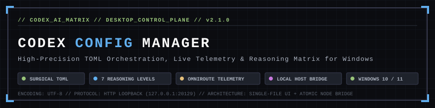
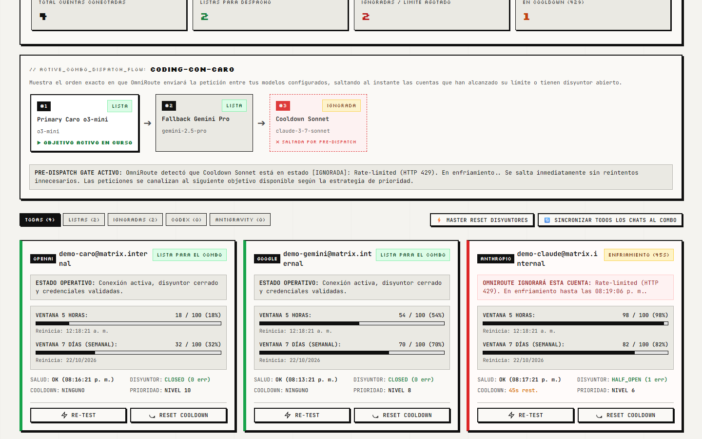
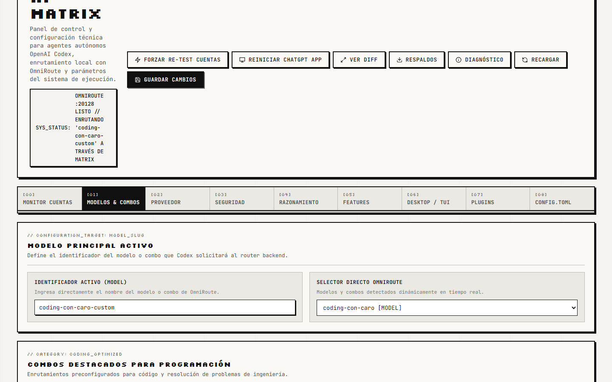
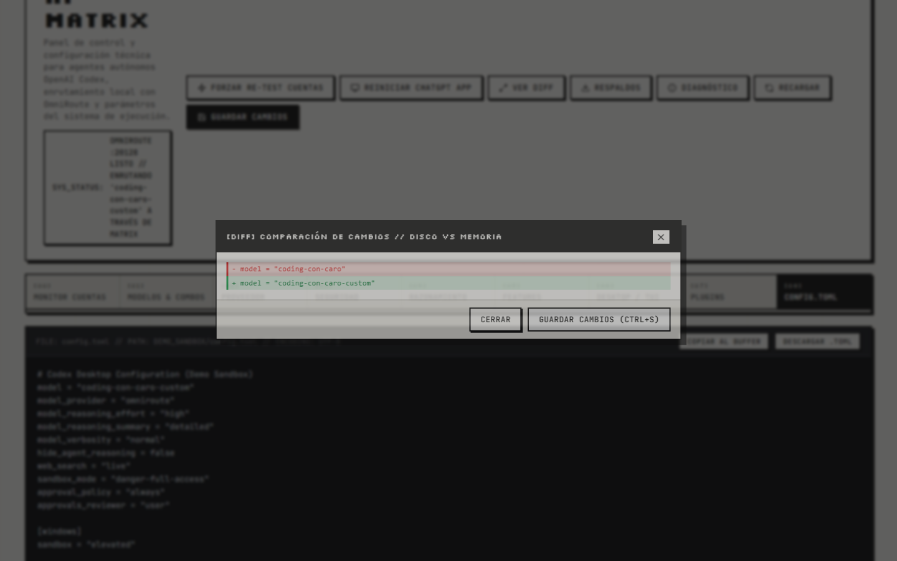
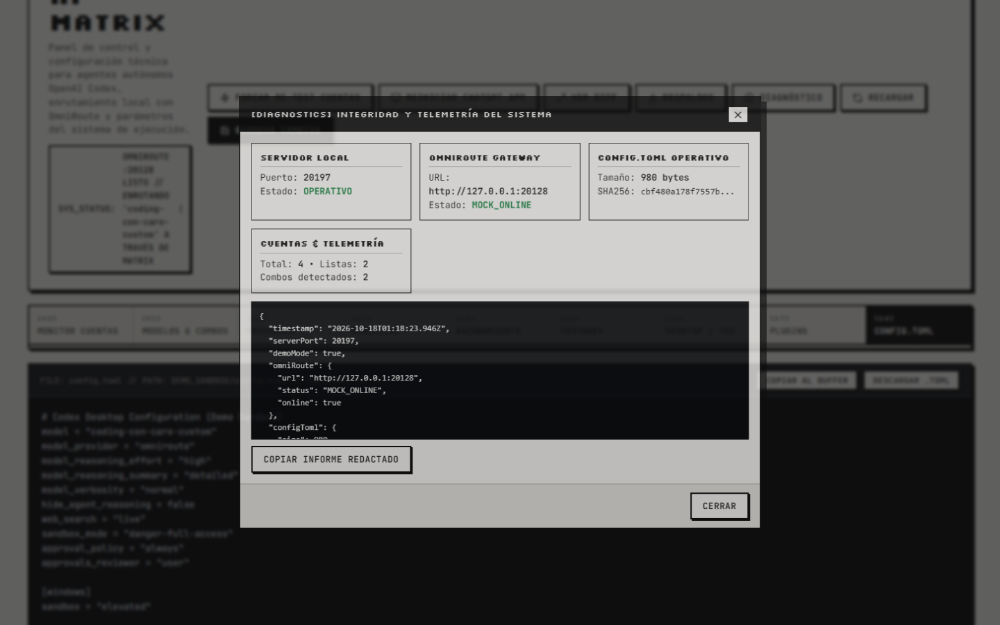
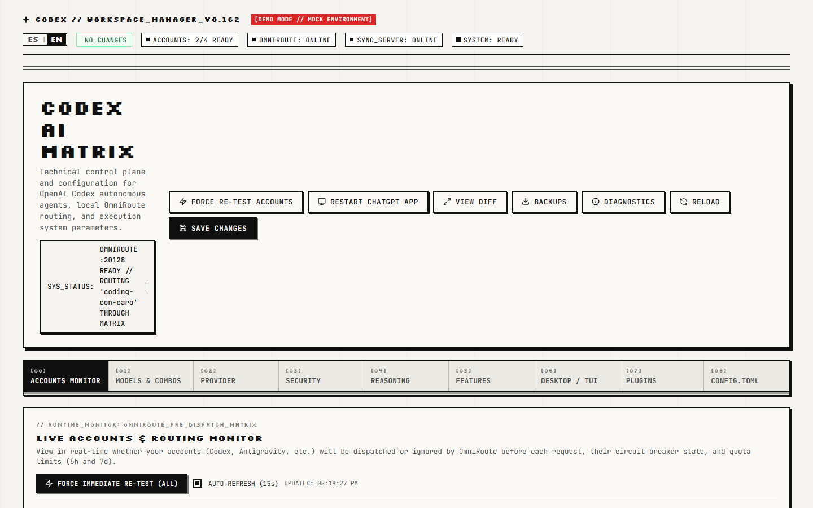

<p align="center">
  
</p>

<p align="center">
  <a href="https://github.com/santi-osp/codex-config-manager/actions/workflows/ci.yml"></a>
  
  
  
  
  
</p>

---

## ⚡ Overview

**Codex Config Manager** (also known as *Codex AI Matrix*) is a technical desktop control plane and telemetry monitor designed for developers running **OpenAI Codex Desktop** alongside **OmniRoute** on Microsoft Windows.

Managing multi-model routing, provider failovers, reasoning parameters, and background daemon execution across fragmented configuration files can be precarious. A single syntax error or aggressive parser rewrite can erase custom `[projects."..."]` tables, invalidate approvals, or corrupt active chat threads.

Codex Config Manager solves this by coupling a **Surgical Round-Trip TOML Engine** with a **Single-File Retro-Pixel Frontend** and a hardened **Loopback Micro-Bridge**. It delivers real-time pre-dispatch telemetry, non-destructive configuration updates, atomic disk writes, automated rolling backups, and seamless ChatGPT Desktop thread synchronization.

---

## 🖥️ Visual Tour

### 1. Live Accounts Telemetry & Pre-Dispatch Matrix
Real-time monitoring of all OmniRoute provider accounts, active combo pipelines, 5-hour / 7-day quotas, and circuit breaker states.
<p align="center">
  
</p>

### 2. Multi-Model Combos & Routing Orchestration
Seamless model combo selection, dirty-state change tracking, and parameter tuning.
<p align="center">
  
</p>

### 3. Real-Time Config Diff Preview
Line-by-line visual difference audit before committing any changes to disk.
<p align="center">
  
</p>

### 4. System Diagnostics & Health Telemetry
Redacted runtime diagnostics inspecting gateway connectivity, TOML hash integrity, and active models.
<p align="center">
  
</p>

### 5. Instant Bilingual Desktop Interface (Español / English)
Zero-reload language switching between Spanish and English, preserving active input buffers, dirty state, and open modals with persistent `localStorage` preference.
<p align="center">
  
</p>

---

## 🛡️ Core Capabilities

- **Instant Bilingual UI (Español / English)**: Complete in-place localization across all 9 tabs, real-time telemetry badges, modal dialogs, and dynamic combo pipelines with zero page reloads and instant retro-segmented switching.
- **Surgical Round-Trip TOML Engine**: Modifies targeted configuration keys in place without stripping comments, altering indentation, or destroying unmapped custom sections (e.g. `[projects."..."]`, `[mcp_servers.*]`).
- **All 7 Reasoning Effort Levels**: Fully exposes and preserves `none`, `low`, `medium`, `high`, `xhigh`, `max`, and `ultra` along with `model_reasoning_summary` and `model_verbosity`. OmniRoute defines effective reasoning dynamically through combo selection.
- **Strict Codex Permissions Preservation**: Never modifies or silently normalizes `sandbox_mode`, `approval_policy`, `approvals_reviewer`, or `windows.sandbox`.
- **Pre-Dispatch Evaluation**: Inspects domain circuit breakers, rate-limit cooldown timers (HTTP 429), and rolling quota windows before dispatch, showing exactly which accounts will be routed or skipped.
- **Zero-Mutation Telemetry Reads**: Reading account statuses or system diagnostics is strictly idempotent and read-only. Telemetry GET requests never write to the database.
- **Atomic Disk Writes & Rolling Backups**: Configuration updates write to a temporary file (`.tmp-[timestamp]`) before executing an atomic rename (`fs.renameSync`). Automated backups preserve up to 10 rolling snapshots with collision detection (`expectedHash`).
- **ChatGPT Thread Synchronization**: Automatically propagates updated models to active conversations in `~/.codex/state_5.sqlite`.
- **Built-in Demo Mode**: Launch with `npm run demo` or visit `?demo=1` to explore the full application using 100% synthetic, privacy-safe mock accounts and fixtures without needing OmniRoute or Codex installed.

---

## 📐 Why a Single-File Frontend?

The entire user interface resides in [`src/web/index.html`](src/web/index.html) as a standalone HTML5 document with inline CSS and vanilla JavaScript:

1. **Zero Frontend Build Step**: No webpack, Vite, Babel, React, or CSS preprocessor overhead. What you read is what executes.
2. **Instant Desktop Rendering**: Opens instantly in any browser or webview with minimal memory footprint.
3. **Auditability**: Security reviewers and developers can inspect all client logic, DOM rendering, and API communication directly in one file.
4. **Resilient Local Bridge**: The lightweight Node.js daemon acts solely as a secure system bridge for file I/O, SQLite operations, and OmniRoute proxying.

---

## 🏛️ System Architecture

```
┌────────────────────────────────────────────────────────────────────────┐
│                        DESKTOP WEB BROWSER / UI                        │
│            (src/web/index.html — Vanilla JS, Zero Bundler)             │
└────────────────────────────────────────────────────────────────────────┘
                                    ▲
                                    │ HTTP Loopback (127.0.0.1:20129)
                                    │ Strict Loopback & Anti-CSRF Guard
                                    ▼
┌────────────────────────────────────────────────────────────────────────┐
│                      LOCAL NODE.JS BRIDGE DAEMON                       │
│                 (src/server/config-manager-server.mjs)                 │
└───────────────────┬────────────────────────────────┬───────────────────┘
                    │                                │
                    ▼                                ▼
     ┌──────────────────────────────┐ ┌────────────────────────────────┐
     │     SURGICAL TOML ENGINE     │ │    OMNIROUTE GATEWAY PROXY     │
     │ (src/server/toml-engine.mjs) │ │    (http://127.0.0.1:20128)    │
     └──────────────┬───────────────┘ └────────────────┬───────────────┘
                    │                                  │
                    ▼                                  ▼
┌───────────────────────────────────┐ ┌────────────────────────────────┐
│       CODEX DESKTOP RUNTIME       │ │      OMNIROUTE TELEMETRY       │
│ - ~/.codex/config.toml (Atomic)   │ │ - storage.sqlite               │
│ - ~/.codex/state_5.sqlite         │ │ - Dynamic Key Resolution       │
│ - Rolling Backups (.backup-*)     │ │ - Circuit Breaker Status       │
└───────────────────────────────────┘ └────────────────────────────────┘
```

---

## 🚀 Quick Start

### Prerequisites
- **Windows 10 / 11**
- **Node.js** >= 22.5.0 *(required for native `node:sqlite`)*

### 1. Installation
Clone the repository and install runtime dependencies:

```powershell
git clone https://github.com/santi-osp/codex-config-manager.git
cd codex-config-manager
npm install
```

### 2. Run in Demo Mode (Zero Setup Required)
To test the full interface with synthetic accounts, combos, and status indicators:

```powershell
npm run demo
```
Open **[http://127.0.0.1:20129](http://127.0.0.1:20129)** in your browser. A red retro badge `[DEMO MODE // MOCK ENVIRONMENT]` indicates that you are in a safe simulation sandbox.

### 3. Run in Production (Live Mode)
To connect to your live OpenAI Codex configuration and local OmniRoute gateway:

```powershell
npm start
```
Open **[http://127.0.0.1:20129](http://127.0.0.1:20129)**.

---

## ⚙️ Environment Configuration

You can override default ports and system paths using environment variables or a `.env` file (see [`.env.example`](.env.example)):

| Variable | Default | Description |
| :--- | :--- | :--- |
| `PORT` | `20129` | HTTP loopback listening port for the configuration manager daemon. |
| `CODEX_DIR` | `%USERPROFILE%\.codex` | Root directory containing Codex configuration files. |
| `CODEX_CONFIG_PATH` | `%CODEX_DIR%\config.toml` | Target `config.toml` file path. |
| `CODEX_STATE_DB_PATH` | `%CODEX_DIR%\state_5.sqlite` | SQLite database for active ChatGPT desktop conversation threads. |
| `OMNIROUTE_URL` | `http://127.0.0.1:20128` | Local gateway URL for OmniRoute. |
| `OMNIROUTE_DB_PATH` | `%APPDATA%\omniroute\storage.sqlite` | OmniRoute telemetry database path. |
| `OMNIROUTE_API_KEY` | *(Dynamic)* | Optional manual override for OmniRoute API key. |
| `DEMO_MODE` | `false` | When set to `true`, serves synthetic fixtures without touching disk. |

---

## 🧪 Automated Testing & Verification

Codex Config Manager includes an automated test battery with 165 comprehensive test scenarios across 6 specialized suites:

```powershell
# Run all test suites (Unit, i18n Static, Security, Real Disk Persistence, Playwright E2E)
npm test

# Run individual suites
npm run test:unit        # 45 Unit tests (TOML parsing, surgical updates, comment & CRLF preservation, hash checks)
npm run test:i18n        # 44 i18n tests (22 Static dictionary symmetry & quality + 22 Playwright bilingual E2E)
npm run test:security    # 27 Security tests (Loopback, Host/Origin guard, secrets audit, env loader, DI)
npm run test:disk        # 29 Real Disk Persistence tests (Atomic writes, 409 conflict, backup restore, SQLite sync)
npm run test:e2e         # 20 Playwright Synthetic UI browser automation scenarios
npm run docs:screenshots # Regenerate documentation screenshots via Playwright
```

For detailed test architecture, localization guides, and coverage reports, see [`docs/I18N.md`](docs/I18N.md), [`docs/TESTING.md`](docs/TESTING.md), and [`docs/RELEASE_CHECKLIST.md`](docs/RELEASE_CHECKLIST.md).

---

## 🔒 Security Policy

For vulnerability reporting procedures, network boundaries, and threat model details, refer to [`SECURITY.md`](SECURITY.md).

---

## 🤝 Contributing

Contributions adhering to the single-file UI architecture and non-destructive TOML preservation rules are welcome. Please read [`CONTRIBUTING.md`](CONTRIBUTING.md) before submitting pull requests.

---

## 📄 License

This project is licensed under the **MIT License** — see the [`LICENSE`](LICENSE) file for details.

Developed with precision by [Santiago Ospina](https://github.com/santi-osp).
