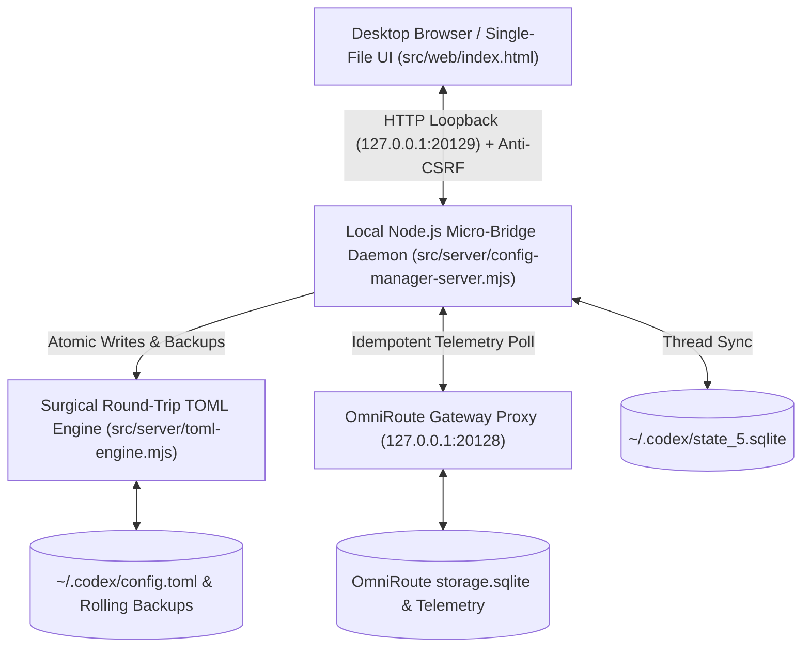

<p align="center">
  
</p>

<p align="center">
  <a href="https://github.com/santi-osp/codex-config-manager/actions/workflows/ci.yml"></a>
  
  
  
  
  
</p>

<p align="center">
  
</p>

## ⚡ Overview

**Codex Config Manager** (also known as *Codex AI Matrix*) is a technical desktop control plane and telemetry monitor designed for developers running **OpenAI Codex Desktop** alongside **OmniRoute** on Microsoft Windows.

Managing multi-model routing, provider failovers, reasoning parameters, and background daemon execution across fragmented configuration files can be precarious. A single syntax error or aggressive parser rewrite can erase custom `[projects."..."]` tables, invalidate approvals, or corrupt active chat threads.

Codex Config Manager solves this by coupling a **Surgical Round-Trip TOML Engine** with a **Single-File Retro-Pixel Frontend** and a hardened **Loopback Micro-Bridge**. It delivers real-time pre-dispatch telemetry, non-destructive configuration updates, atomic disk writes, automated rolling backups, and seamless ChatGPT Desktop thread synchronization.

<p align="center">
  
</p>

## 🖥️ Visual Tour

### 1. Live Accounts Telemetry & Multi-Model Routing
Real-time monitoring of all OmniRoute provider accounts, active combo pipelines, 5-hour / 7-day quotas, and circuit breaker states with dirty-state change tracking.

| Live Accounts Telemetry & Quota Monitor | Multi-Model Combos & Routing Orchestration |
| :---: | :---: |
|  |  |

<br>

### 2. Surgical Difference Audit & Diagnostics Modal
Line-by-line visual difference audit before committing any changes to disk, plus redacted runtime diagnostics inspecting gateway connectivity and TOML hash integrity.

| Real-Time Config Diff Preview | System Diagnostics & Health Telemetry |
| :---: | :---: |
|  |  |

<br>

### 3. Instant Bilingual Desktop Interface (Español / English)
Zero-reload language switching between Spanish and English, preserving active input buffers, dirty state, and open modals with persistent `localStorage` preference.

<p align="center">
  
</p>

<p align="center">
  
</p>

## 🛡️ Core Capabilities

- **Instant Bilingual UI (Español / English)**: Complete in-place localization across all 9 tabs, real-time telemetry badges, modal dialogs, and dynamic combo pipelines with zero page reloads and instant retro-segmented switching.
- **Surgical Round-Trip TOML Engine**: Modifies targeted configuration keys in place without stripping comments, altering indentation, or destroying unmapped custom sections (e.g. `[projects."..."]`, `[mcp_servers.*]`).
- **All 7 Reasoning Effort Levels**: Fully exposes and preserves `none`, `low`, `medium`, `high`, `xhigh`, `max`, and `ultra` along with `model_reasoning_summary` and `model_verbosity`. OmniRoute defines effective reasoning dynamically through combo selection.
- **Strict Codex Permissions Preservation**: Never modifies or silently normalizes `sandbox_mode`, `approval_policy`, `approvals_reviewer`, or `windows.sandbox`.
- **Pre-Dispatch Evaluation**: Inspects domain circuit breakers, rate-limit cooldown timers (HTTP 429), and rolling quota windows before dispatch, showing exactly which accounts will be routed or skipped.
- **Zero-Mutation Telemetry Reads**: Reading account statuses or system diagnostics is strictly idempotent and read-only. Telemetry GET requests never write to the database.
- **Atomic Disk Writes & Rolling Backups**: Configuration updates write to a temporary file (`.tmp-[timestamp]`) before executing an atomic rename (`fs.renameSync`). Automated backups preserve up to 10 rolling snapshots with collision detection (`expectedHash`).
- **ChatGPT Thread Synchronization**: Automatically propagates updated models to active conversations in `~/.codex/state_5.sqlite`.
- **Built-in Demo Mode**: Launch with `npm run demo` or visit `?demo=1` to explore the full application using 100% synthetic, privacy-safe mock accounts and fixtures without needing OmniRoute or Codex installed.

---

## 📐 Why a Single-File Frontend?

The entire user interface resides in [`src/web/index.html`](src/web/index.html) as a standalone HTML5 document with inline CSS and vanilla JavaScript:

1. **Zero Frontend Build Step**: No webpack, Vite, Babel, React, or CSS preprocessor overhead. What you read is what executes.
2. **Instant Desktop Rendering**: Opens instantly in any browser or webview with minimal memory footprint.
3. **Auditability**: Security reviewers and developers can inspect all client logic, DOM rendering, and API communication directly in one file.
4. **Resilient Local Bridge**: The lightweight Node.js daemon acts solely as a secure system bridge for file I/O, SQLite operations, and OmniRoute proxying.

---

## 🏛️ System Architecture



---

## 🚀 Quick Start

### Prerequisites
- **Windows 10 / 11**
- **Node.js** >= 22.5.0 *(required for native `node:sqlite`)*

### 1. Installation
Clone the repository and install runtime dependencies:

```powershell
git clone https://github.com/santi-osp/codex-config-manager.git
cd codex-config-manager
npm install
```

### 2. Run in Demo Mode (Zero Setup Required)
To test the full interface with synthetic accounts, combos, and status indicators:

```powershell
npm run demo
```
Open **[http://127.0.0.1:20129](http://127.0.0.1:20129)** in your browser. A red retro badge `[DEMO MODE // MOCK ENVIRONMENT]` indicates that you are in a safe simulation sandbox.

### 3. Run in Production Mode
Connects directly to your live `~/.codex/config.toml`, `~/.codex/state_5.sqlite`, and local OmniRoute gateway:

```powershell
npm start
```

### 4. Background Daemon (Tray / Headless)
```powershell
.\scripts\start-daemon.ps1
```
To stop the background process:
```powershell
.\scripts\stop-daemon.ps1
```

---

## 🧪 Automated Testing Suite

The repository includes a comprehensive, multi-layer automated test suite:

```powershell
# Run the complete test suite (165 passing tests)
npm test

# Run specifically the Surgical TOML Engine tests
npm run test:toml

# Run live system integration tests
npm run test:integration

# Execute Playwright E2E visual & workflow tests
npm run test:e2e
```

---

## 📁 Repository Structure

```text
codex-config-manager/
├── assets/                      # Application icons and pixel graphics
├── docs/
│   ├── images/
│   │   ├── readme-hero.svg      # Retro-pixel vector banner
│   │   ├── divider.svg          # Cyberpunk SVG divider
│   │   └── *.png                # Interface screenshots (diff, routing, telemetry)
│   └── specifications/          # Architecture blueprints and RFCs
├── scripts/
│   ├── start-daemon.ps1         # Windows headless daemon launcher
│   └── stop-daemon.ps1          # Clean task termination script
├── src/
│   ├── server/                  # Node.js Loopback Bridge & Surgical TOML parser
│   └── web/
│       └── index.html           # Single-file zero-bundler retro-pixel interface
├── tests/                       # Unit, integration, and E2E regression tests
├── package.json
└── README.md
```

---

## 👨‍💻 Author & License

Created and maintained by **Santiago Ospina Arango**  
- **GitHub:** [@santi-osp](https://github.com/santi-osp)  
- **License:** [MIT License](LICENSE)

---

<p align="center">
  <sub>Codex Config Manager · Built for precision, non-destructive safety, and developer control on Windows.</sub>
</p>